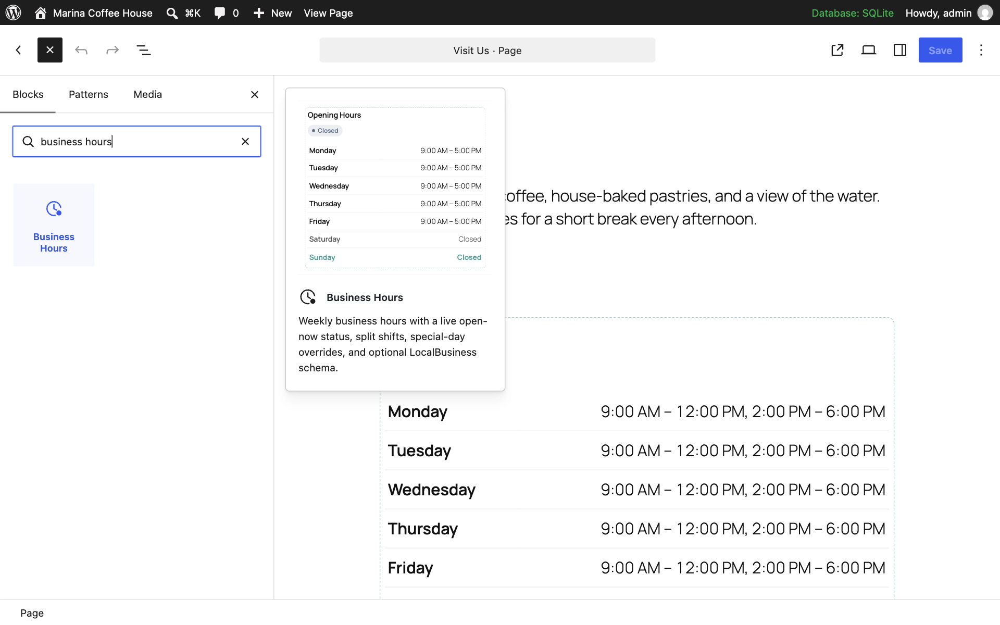
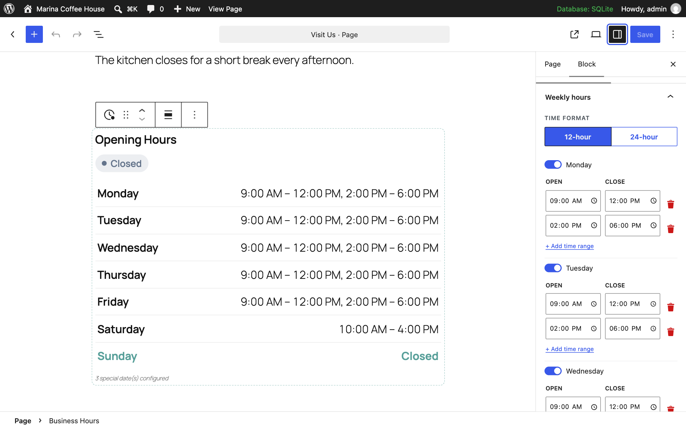
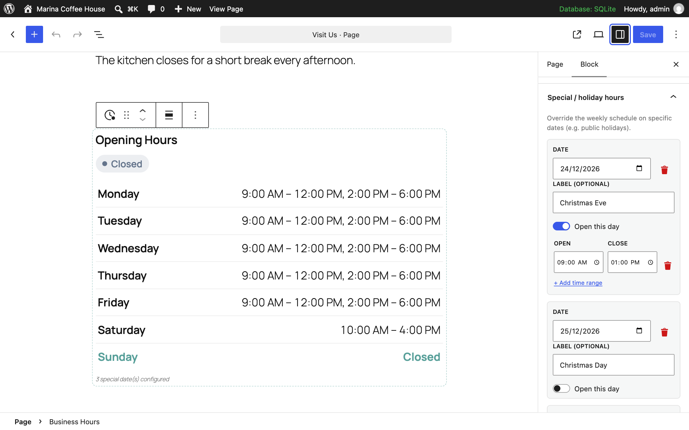
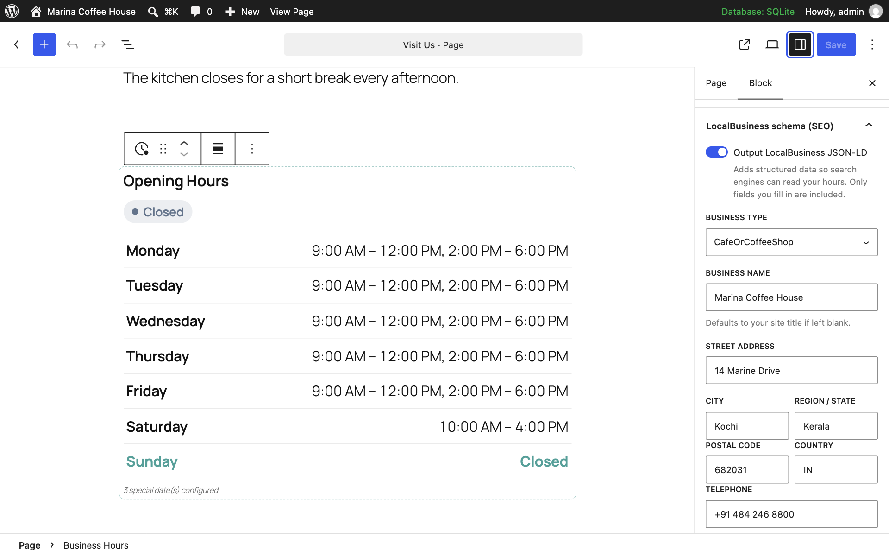
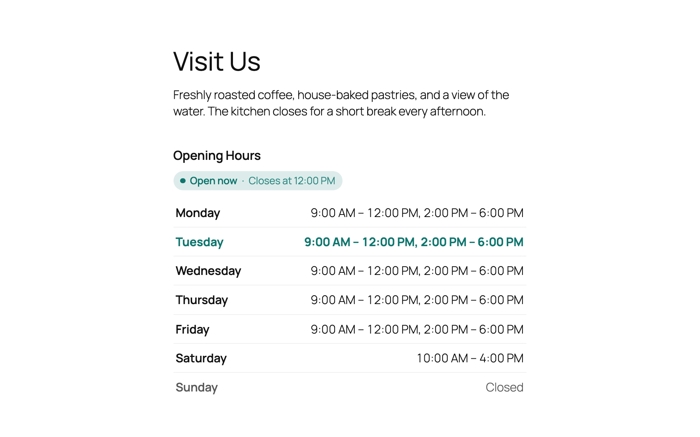
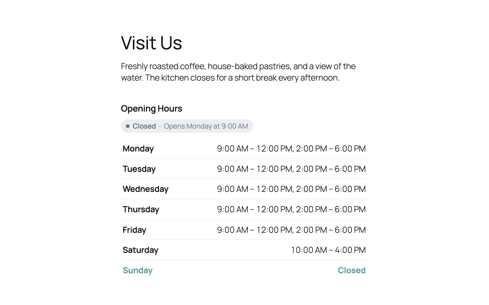

> ⚠️ **Please fork this repo** rather than cloning directly.
> For installation, download from [WordPress.org](https://wordpress.org/plugins/idara-business-hours/) only.


# Idara Business Hours

Weekly opening hours with a live "Open now / Closed" status and optional LocalBusiness schema. A lightweight, FSE-ready Gutenberg block that loads only where used — no bloat, no tracking.

<!-- Uncomment these once the plugin is live on WordPress.org — until then they render as "not found".
[](https://wordpress.org/plugins/idara-business-hours/)
[](https://wordpress.org/plugins/idara-business-hours/advanced/)
[](https://wordpress.org/plugins/idara-business-hours/#reviews)
[](https://wordpress.org/plugins/idara-business-hours/)
-->
[](https://www.gnu.org/licenses/gpl-2.0.html)

**WordPress.org:** submitted, awaiting review
**Version:** 1.0.0 · **Requires WP:** 6.5+ · **Requires PHP:** 7.4+ · **License:** GPL-2.0-or-later

---

## Features

- Weekly hours editor, Monday–Sunday, each day open or closed
- **Split shifts** — several open→close ranges per day (e.g. `9:00–12:00, 2:00–6:00`)
- Live **"Open now / Closed"** status pill, with an "opens at…" / "closes at…" hint
- **Special / holiday hours** — date-specific overrides that replace the weekly schedule
- Optional **LocalBusiness JSON-LD** — name, address, phone, and the same opening hours
- 12-hour or 24-hour time display
- Highlights the current day
- Per-block timezone override, defaulting to the site timezone
- Inherits theme color and typography via block supports
- Full Site Editing (FSE) compatible — works in templates and template parts
- CSS and JS load **only on pages where the block is present** — never globally
- No tracking, no external requests, no third-party services
- Translation-ready

---

## Screenshots

**Editor / Backend**

| Block inserter | Weekly hours editor | Special / holiday hours |
|---|---|---|
|  |  |  |

| LocalBusiness schema panel |
|---|
|  |

**Frontend**

| Open now, with today highlighted | Closed, showing when it reopens |
|---|---|
|  |  |

---

## Installation

**From WordPress.org:**

1. Go to **Plugins → Add New** and search for `Idara Business Hours`
2. Click **Install Now**, then **Activate**
3. Open any post or page → click **+** → search **Business Hours** → place the block

**Manual upload:**

1. Download the zip from [WordPress.org](https://wordpress.org/plugins/idara-business-hours/)
2. Go to **Plugins → Add New → Upload Plugin**
3. Upload and activate

---

## Block settings

| Setting | Description |
|---|---|
| Weekly hours | Each day open or closed, with one or more time ranges per day |
| Time format | 12-hour or 24-hour |
| Special / holiday hours | Date overrides (`YYYY-MM-DD`) with an optional label, open or closed |
| Heading | Optional heading above the table |
| Show status | Toggle the live "Open now / Closed" pill |
| Highlight today | Emphasise the current weekday row |
| Hide closed days | Leave closed days out of the table entirely |
| Accent color | Any CSS color (hex, rgb, hsl, named) |
| Timezone | Defaults to the site timezone; override per block |
| LocalBusiness schema | Toggle JSON-LD, plus business type, name, address, phone, price range, URL |

---

## Development

**Requirements:** Node.js 18+, npm

```bash
git clone https://github.com/sajid-ansari-65/idara-business-hours.git
cd idara-business-hours
npm install
```

| Command | Description |
|---|---|
| `npm run start` | Watch `src/` and rebuild on change |
| `npm run build` | Production build → `build/` |
| `npm run plugin-zip` | Generate installable `idara-business-hours.zip` |
| `npm run lint:js` / `lint:css` | Lint the sources |

> **Build flag:** `start` and `build` both pass `--experimental-modules`. The frontend script is declared as `viewScriptModule` (Interactivity API), and without that flag `build/view.js` is **silently not produced** — the block loads with no frontend behavior and no error.

**Source → build mapping:**

| Source | Built output | Purpose |
|---|---|---|
| `src/index.js` + `src/edit.js` | `build/index.js` | Editor UI (React, `@wordpress/blocks`) |
| `src/view.js` | `build/view.js` | Frontend status module (Interactivity API, ~2 KB) |
| `src/style.scss` | `build/style-index.css` | Frontend + editor shared styles |
| `src/editor.scss` | `build/index.css` | Editor-only styles |
| `src/render.php` | `build/render.php` | Server-side dynamic render (copied by wp-scripts) |
| `src/block.json` | `build/block.json` | Block metadata |

`build/` is minified, so `src/` ships inside the distributed zip as well — WordPress.org requires the human-readable source alongside compiled code. That is what the `files` field in `package.json` is for.

---

## Architecture notes

- **Cache-safe status** — "Open now / Closed" is computed in the visitor's browser against the *business* timezone via `Intl.DateTimeFormat`, not server-side. A server-rendered status goes stale the moment the page is cached or served from a CDN. `render.php` still emits a correct server-side result as the no-JS and crawler fallback, so the two never disagree on first paint.
- **Times are formatted once, in PHP** — `date_i18n()` produces the localized AM/PM strings, which are passed pre-formatted into the Interactivity context. JS never re-formats, so PHP and JS output cannot drift apart.
- **`viewScriptModule`** in `block.json` — WordPress auto-enqueues the module only on pages containing the block. No global enqueue. See the build-flag warning above.
- **Schedule precedence** — a special-date override wins over the weekly schedule for that date. Slots that cross midnight (`22:00–02:00`) are handled explicitly rather than assumed to be invalid.
- **JSON-LD hardening** — output goes through `wp_json_encode()` with `JSON_HEX_TAG`, which prevents a `</script>` breakout from user-entered fields. Only filled-in fields are emitted, and `businessType` is validated against an allow-list.
- **Input validation** — times are regex-checked as `HH:MM`, special dates as `YYYY-MM-DD`, and the accent color passes through a CSS-safe character whitelist rather than `sanitize_hex_color()`, so `rgb()`, `hsl()` and named colors keep working.
- **No experimental WordPress APIs** — the inspector uses local `Spacer` / `Text` helpers instead of `__experimentalSpacer` / `__experimentalText`, which WordPress can rename or remove without a deprecation cycle.

---

## Contributing

Found a bug or have a feature idea? [Open an issue](https://github.com/sajid-ansari-65/idara-business-hours/issues).

All pull requests welcome. Please test against WordPress 6.5+ and a block theme before submitting.

---

## About Idara

**Idara** (إدارة) is an Arabic word meaning "studio" or "administration." It's a small plugin studio building single-purpose, carefully crafted Gutenberg blocks — one problem, one plugin.

| Plugin | Description |
|---|---|
| [Idara Reading Time](https://wordpress.org/plugins/idara-reading-time/) | Estimated reading time with an optional scroll progress bar |
| Idara Business Hours | This plugin |

[WordPress.org profile](https://profiles.wordpress.org/sajidansari65/)

---

## License

GPL-2.0-or-later — see [LICENSE](https://www.gnu.org/licenses/gpl-2.0.html)
